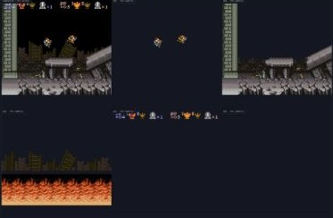
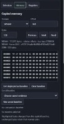
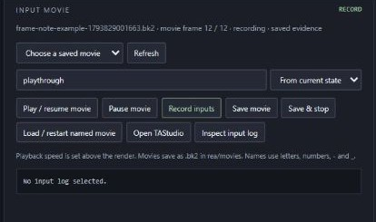
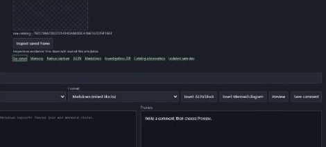

# SUPER REAPER - BizHawk

A Super Nintendo inspection workbench for **BizHawk 2.11.1 / BSNESv115+**, with TAS/input movies and frame-linked investigation notes.

## Workbench features

The **v0.2.0 Windows setup package** includes native sprite and tile tracking and tracked frame attachments for **BizHawk 2.11.1**. Click any crop to enlarge it. [Download v0.2.0](https://github.com/Bertzerker/SUPER-REAPER-BizHawk/releases/tag/v0.2.0)

| Feature | Cropped example |
| --- | --- |
| **Native SNES layers.** Inspect Composite, OBJ and BG1–4 from one FastPPU capture. The isolated views preserve renderer samples before inter-layer color math, while Composite shows the final blend. | <a href="docs/rea-features/graphics.jpg"></a> |
| **Pinned memory and experiments.** Keep a pixel selection, registers and copied memory on one capture. Compare live or archived baselines, restore compatible checkpoints, and interrupt bounded frame-step experiments. | <a href="docs/rea-features/memory.jpg"></a> |
| **BK2 and TAStudio.** Record input from power-on or the current state. Load a BK2, play it read-only, inspect input rows, or open native TAStudio. | <a href="docs/rea-features/movies.jpg"></a> |
| **Catalog and saved comments.** Name and isolate OBJ or background tile matches, follow one occurrence, and attach its exact frame during live play or BK2 replay. Saved comments preserve the selection, catalog revision and movie row with Markdown, JSON or Mermaid notes and a verifiable investigation ZIP. Catalog attribution was tested in Modes 0 and 1. | <a href="docs/rea-features/catalog.jpg"></a> |

## Quick start on Windows

Extract `SUPER-REAPER-BizHawk-v0.2.0-win-x64-setup.zip` and open a terminal in the extracted folder. Install **PowerShell 7** and **Node.js 22 or newer**. Python 3 is needed only for generated diagnostic games and the independent ZIP verifier/tests. Use an absolute installed interpreter path with `REA_PYTHON`.

```powershell
./Setup.ps1
./snes/rea/Start-REA.ps1 -Rom 'C:/path/to/your/game.sfc' -Wait
```

Open **http://127.0.0.1:8900/**. Play with the keyboard/controller configured in the native BizHawk window. The launcher refuses a second instance. Closing its BizHawk window also stops its server when `-Wait` is used.

Setup downloads the official pinned BizHawk release, verifies SHA256, and installs the included matching REA DLL/native core. It never launches an emulator or changes a system-wide installation. It refuses replacement while BizHawk is running. `Setup.ps1 -VerifyOnly` checks bundled binaries without installing anything; `-Archive` accepts an already downloaded release ZIP.

The setup archive includes sanitized regression fixtures from this project's original diagnostic programs. Games, firmware, user movies, checkpoints, catalogs, and saved notes stay in your local installation.

For an original diagnostic instead of a commercial game:

```powershell
$env:REA_PYTHON = 'C:/path/to/installed/python.exe'
./snes/rea/Start-REA.ps1 -Diagnostic -Mute -Wait
```

Auto region detection follows the ROM header. Some beta ROMs with USA filenames identify as PAL. Change the region deliberately in native SNES sync settings if needed; matching sync settings are required for movies/checkpoints. This checkout does not publish a machine-specific NTSC override.

## Inspect and document a frame

Selecting a pixel pins its capture before lookup. The adjacent Selection, Memory and Registers tools use that evidence. **Resume inspection** returns to live presentation without changing the machine's playback state.

**Comment displayed** saves the visible frame while the machine may continue; **Pause & capture current frame** pauses and captures the current machine state. Write Markdown with fenced `json`/`mermaid` blocks, or choose standalone JSON/Mermaid. Saved evidence can be inspected after restart without rewinding the emulator. **Export evidence ZIP** and saved-note **Investigation ZIP** downloads include manifests; archived BK2 is included when attached to a saved note.

In **Sprite & tile catalog**, enable native sampling and use **Inspect latest catalog frame** to pick a source for an entry. Return to live, show matches, select a candidate and choose **Follow instance**. **Pin catalog result** and **Attach to comment** save the chosen occurrence with its isolated image, catalog revision and, during a movie, the frame and preceding input row. See the [catalog walkthrough](snes/rea/README.md#sprite--tile-catalog).

## Build, source and tests

The repository contains the REA source, reviewable native overlay, pinned dependency archives, bundled browser renderer/notices, and ready-to-install matching binaries under `dist/`. `dist/manifest.json` records their SHA256 and sizes. Upstream BizHawk assemblies remain unchanged; only the external tool and the BSNES native observer are added.

```powershell
# Download the matching complete upstream source as well as the emulator.
./Setup.ps1 -WithSource

# Requires .NET SDK Roslyn and .NET Framework 4.8 developer/reference assemblies.
# Close BizHawk first; never build over a loaded tool/core.
./snes/rea/Build.ps1

# Original diagnostic fixture tests; no emulator launch or commercial ROM needed.
$env:REA_PYTHON = 'C:/path/to/installed/python.exe'
./Test.ps1
```

See [native implementation/build instructions](snes/rea/native/README.md), [detailed usage and local API](snes/rea/README.md), and [implementation scope](snes/rea/SPEC.md). Native rebuilding uses WSL Ubuntu with two compilation jobs; source generation and native installation refuse a running BizHawk instance. The corresponding base source is the pinned [BizHawk 2.11.1 tag](https://github.com/TASEmulators/BizHawk/tree/2.11.1), plus this repository's `snes/rea/native` overlay and the pinned dependencies documented there.

Browser assets are prebundled for offline use. Rebuild them with `npm ci --prefix snes/rea/ui-deps` followed by `node snes/rea/ui-deps/build.mjs`.

## Validation and limits

19 protocol/API/workbench regression tests passed. The native catalog diagnostic verified OBJ and BG1 tile attachments during live play and read-only BK2 replay. The emulator advanced while each attachment saved its pinned capture. The notes reopened with their original revisions after catalog edits and a server restart. The BK2 SHA256 and the emulated output and core state were unchanged by inspection.

Native catalog identity supports **256-pixel, non-interlaced FastPPU Modes 0–4**. Mode 0 was verified for BG1–4 and Mode 1 for OBJ and BG1 in the live and replay diagnostic. Modes 2–4 use the same tiled renderer and have no dedicated end-to-end catalog runs. Hires, interlace and standard Mode 7 preserve the six views and disable catalog identity. Cycle PPU and enhanced HD Mode 7 layer capture are unavailable.

On the development workstation, a 15-second NTSC run with all six views, native sampling and browser follow measured **60.14 emulated FPS / 60.00 displayed FPS** with zero dropped captures. WebGL is the normal renderer. Its Canvas 2D fallback is capped at 30 displayed updates per second.

Exact CPU/DMA/fetch provenance, bounded CPU trace/watch services and verified commercial-game collision adapters remain unsupported. OAM rectangles are hardware diagnostics, not game hitboxes. The browser supplies inspection/control tools; automatic game completion is not implemented.

## Licenses and upstream

REA tool/server/UI/observer additions: [MIT](LICENSE). BizHawk and included native components retain their respective upstream licenses and notices; the whole emulator/core is not relicensed as MIT. See [BizHawk's notice](snes/LICENSE.BizHawk), the pinned complete upstream source, bundled browser `.LEGAL.txt`, and `licenses/` for dependency license texts. This project is independent of the upstream BizHawk team.
